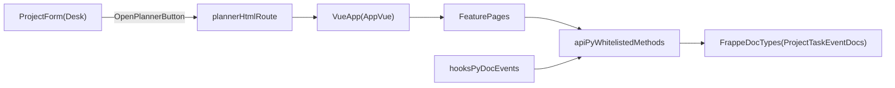
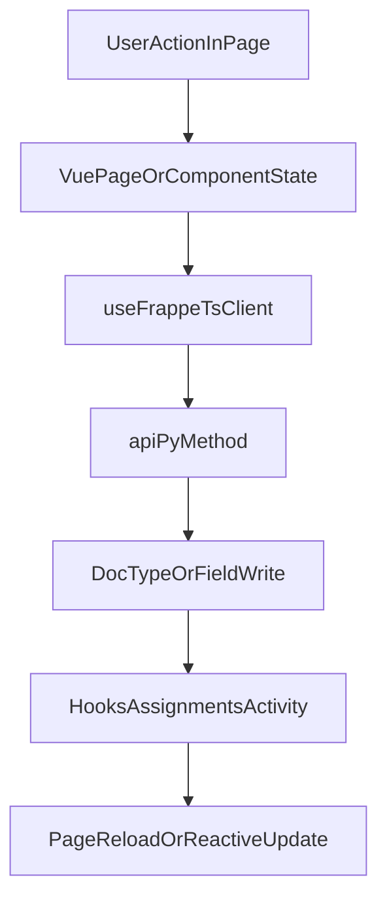

# Event Planner Architecture

## System Overview

`event_planner` is a Frappe app with a Vue 3 SPA frontend. The planner experience is opened from ERPNext Desk and runs under the same authenticated site session.

- **Backend app root:** `event_planner/`
- **Frontend app root:** `frontend/`
- **SPA entry page served by Frappe:** `event_planner/www/planner.html`
- **SPA mount/router bootstrap:** `frontend/src/main.ts`

## Runtime Architecture

## Integration Entry Points

### Desk -> Planner bridge

- `event_planner/public/js/project_button.js` adds **Edit in Planner** on `Project` forms with event-like departments.
- The button opens `/planner#/<project>/landing`.

### Planner hosting page

- `event_planner/www/planner.html`:
  - injects `window.frappe`,
  - includes CSRF template marker,
  - loads built assets from `event_planner/public/frontend/assets`.

### Frontend bootstrap and routing

- `frontend/src/main.ts`:
  - prefetches CSRF token via `ensureCsrfToken()`,
  - creates hash router,
  - routes to Landing, Brief, Action, Timeline, Schedule, Debrief pages.

### Project context provider

- `frontend/src/App.vue`:
  - reads `:project` route parameter,
  - fetches `Project` doc via `useFrappeDoc("Project", projectName)`,
  - provides project context to all nested pages/components.

## Backend Responsibilities

### Hook surface (`event_planner/hooks.py`)

- Declares lifecycle hooks:
  - `after_install`
  - `after_migrate`
  - `before_uninstall`
- Injects Desk JS for:
  - `Project` (`project_button.js`)
  - `Task` (`task_list.js`)
- Registers Task doc event:
  - `before_save -> event_planner.task_hooks.sync_assigned_to_from_assign`
- Exports print format fixtures.

### API layer (`event_planner/api.py`)

Whitelisted methods back the SPA:
- **Session/CSRF:** `get_planner_csrf_token`
- **Landing:** `get_landing_summary`, `get_recent_activity`
- **Task/workspace:** `list_tasks_with_hierarchy`, `reorder_tasks_in_category`
- **Category management:** `list_categories`, `create_category`, `update_category`, `delete_category`, `reorder_categories`
- **Brief/debrief lifecycle:** `create_brief_from_template`, `create_debrief_from_template`
- **Activity/meta:** `get_doc_meta`, `get_activity_log`
- **Template save actions:** `save_brief_as_template`, `save_debrief_as_template`

Many write paths use `ignore_permissions=True` and explicit `frappe.db.commit()`, so extensions should evaluate permission expectations carefully.

### Install/migrate behavior (`event_planner/install.py`)

- Creates/updates app-owned custom fields.
- Seeds default brief/debrief templates.
- Backfills template `kind` values on migrate.
- Attempts frontend build on install (`npm install` + `npm run build`) if assets are missing.
- Cleans app-owned fields and seeded templates on uninstall.

## Frontend Responsibilities

### API client contract

`frontend/src/composables/useFrappe.ts` centralizes:
- session-aware reads/writes against `/api/resource/*` and `/api/method/*`,
- CSRF bootstrap and enforcement for mutating calls,
- composables for reactive document/list loading.

### Feature page ownership

- `Landing.vue` -> project summary and recent activity.
- `Action.vue` -> action categories and task board operations.
- `TimeWorkspace.vue` -> hierarchical task workspace (timeline/boards).
- `Schedule.vue` -> edits project child-table schedules.
- `Brief.vue` -> event brief lifecycle and content editing.
- `Debrief.vue` -> event debrief lifecycle and content editing.

## Data Ownership Model

### Standard doctypes reused

- `Project`
- `Task`
- `Comment`
- `Version`
- `ToDo`

### App-specific doctypes

Under `event_planner/event_planner/doctype/`:
- `Action Category`
- `Event Brief`
- `Event Debrief`
- `Event Brief Template`
- child doctypes for schedule tables (`Time Schedule`, `Equipment Schedule`, `Crew Schedule`, `Vehicle Schedule`)

### App-owned custom fields

Defined in `event_planner/custom_fields.py`:
- On `Project`: event schedule status/location and 4 child table fields (`ep_time_schedule`, `ep_equipment_schedule`, `ep_crew_schedule`, `ep_vehicle_schedule`)
- On `Task`: `ep_action_category`, `ep_sort_order`, and `assigned_to` compatibility field

## Request and Persistence Flow

## CI and Quality Gates (High Level)

- Python/Node versions and bench-based test flow are defined in `.github/workflows/ci.yml`.
- Linting/security checks are defined in `.github/workflows/linter.yml`.
- Pre-commit tooling is documented in root `README.md`.
